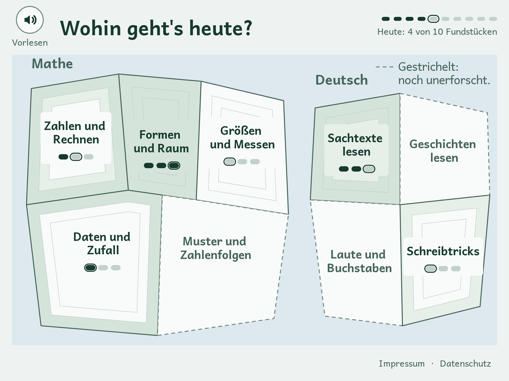
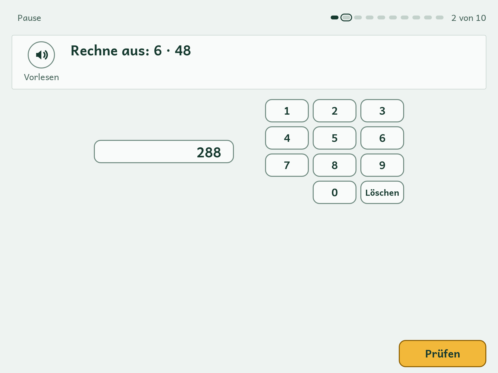

# Pfadfinder

Kostenlose Übungs-App für Kinder der 4. Klasse in Baden-Württemberg zur Vorbereitung auf Kompass 4 (Deutsch und Mathe). Keine Anmeldung, keine Werbung, kein Tracking; alle Daten bleiben auf dem Gerät. Läuft als PWA auf Tablet, Laptop und Handy, nach dem ersten Laden auch offline.

Live: https://kompassheld.de · Für Eltern und Lehrkräfte: https://kompassheld.de/eltern

Kompass 4 ist eine Lernstandserhebung des Landes Baden-Württemberg. Pfadfinder ist ein privates Projekt und nicht damit verbunden. Die Aufgaben sind selbst geschrieben, mit Hilfe von KI, an den Tests 2024 und 2025 orientiert und nicht amtlich geprüft; eine Durchsicht durch eine Lehrkraft läuft. Die Original-Tests (Prüfungsaufgaben, Testhefte, Scans) liegen nicht im Repo und dürfen nie hinein – auch nicht umformuliert.




## Lizenzen

Code: MIT ([`LICENSE`](LICENSE)). Aufgaben, Texte und Bilder unter `content/`: CC BY-SA 4.0, Urheber Markus Steireif ([`content/LICENSE`](content/LICENSE)). Schrift Andika (SIL Global): SIL Open Font License 1.1 ([`public/fonts/andika/OFL.txt`](public/fonts/andika/OFL.txt)).

## Mitmachen ohne Technik

Eine Aufgabe vorschlagen oder einen Fehler melden geht per E-Mail an pfadfinder@steireif.de; eine Vorlage öffnet sich auf https://kompassheld.de/eltern. Oder Sie legen hier ein Issue mit der Vorlage „Aufgabe vorschlagen“ an.

## Selbst betreiben oder erweitern

Voraussetzungen: Node.js ≥ 22.22, npm.

```sh
git clone https://github.com/1701/Pfadfinder.git   # oder Ihr Fork
cd Pfadfinder
npm install
npm run dev     # Entwicklung, Adresse steht im Terminal
npm run check   # Lint, Content-Prüfung, Unit-Tests, Build – Pflicht vor jedem Commit und jedem Pull Request
```

Aufgaben liegen als JSON unter `content/items/<fach>/<bereich>.json` (z. B. `content/items/mathe/zahlen-operationen.json`); Lesetexte unter `content/texts/deutsch/`, Probetests unter `content/probetests/`, Bilder als SVG unter `content/assets/svg/`. Jede Aufgabe folgt dem Vertrag in `docs/CONTENT_SCHEMA.md`. So sieht eine kurze Aufgabe aus:

```json
{
  "id": "m-zo-1-001",
  "schemaVersion": "1.0",
  "fach": "mathe",
  "bereich": "zahlen-operationen",
  "niveau": 1,
  "format": "number-input",
  "status": "draft",
  "prompt": "Rechne aus: 4 735 + 2 868",
  "readAloud": "Rechne aus: 4735 plus 2868",
  "payload": { "maxDigits": 5 },
  "solution": { "value": 7603 },
  "feedback": {
    "correct": "Richtig! Du hast an jeder Stelle den Übertrag mitgenommen.",
    "incorrect": "Rechne stellenweise von rechts: 5 + 8 = 13, die 1 wandert zur nächsten Stelle. Prüfe jede Stelle so.",
    "misconception": "Viele vergessen den Übertrag in die Hunderterstelle."
  },
  "tags": ["schriftliche-addition", "uebertrag"],
  "estimatedSeconds": 60,
  "meta": { "author": "claude", "createdAt": "2026-10-11", "calibration": "original-2024" }
}
```

`npm run content:validate` prüft jede Aufgabe gegen den Vertrag und erzeugt `content/manifest.json`; die App liest nur Manifest und Inhalte, nie etwas aus dem Netz. `content/typen.json` nennt je Bereich die Aufgabentypen für die Elternseite und wird mit jedem Aufgaben-Batch gepflegt.

Eigene Instanz: Die App ist rein statisch. `npm run build` erzeugt `dist/`; jeder statische Hoster reicht. Wir liefern über Cloudflare Workers mit Static Assets (Build bei Push); Einrichtung in `docs/DEPLOY.md`. Beim Betrieb unter eigenem Namen: Impressum, Datenschutzerklärung und Kontaktadresse anpassen (`src/ui/text/rechtliches.ts`, `src/ui/text/kontakt.ts`).

Weitere Dokumentation: `docs/PRODUCT.md` (was und warum), `docs/ARCHITECTURE.md` (wie), `docs/PROGRESS.md` (was zuletzt passiert ist). Wer mit Claude Code oder einem anderen Agenten arbeitet: `CLAUDE.md` enthält die Arbeitsregeln.

## Beitragen mit Pull Request

Siehe [`CONTRIBUTING.md`](CONTRIBUTING.md).
